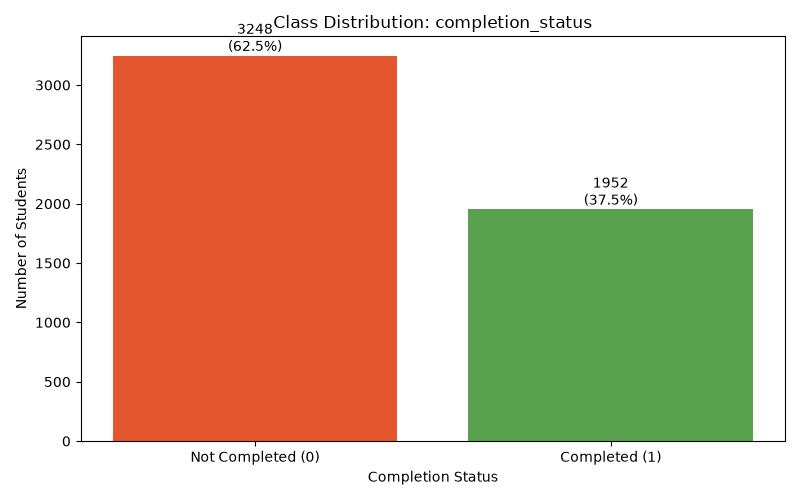
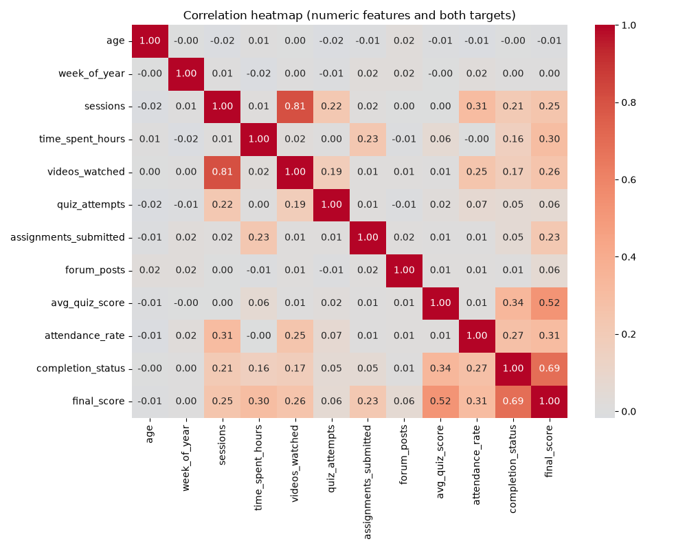
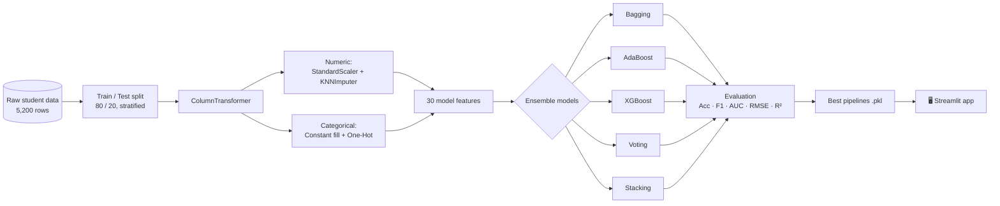
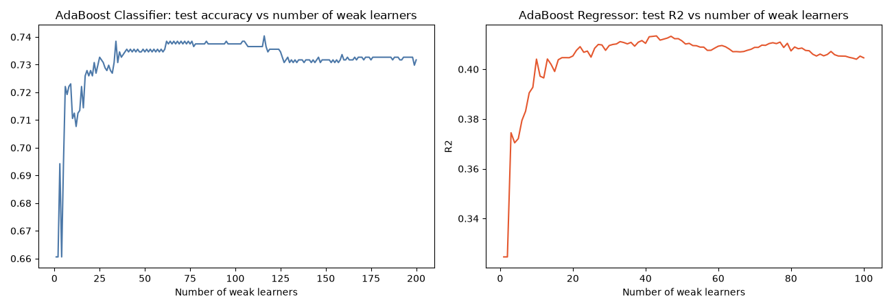
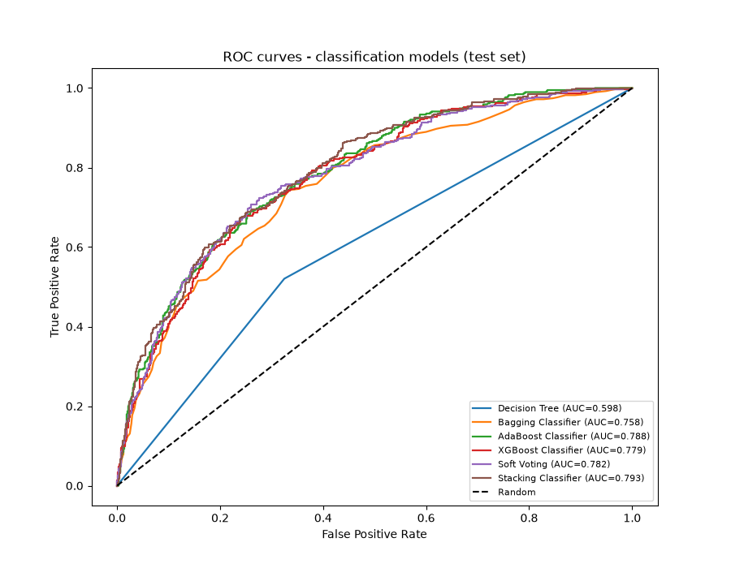
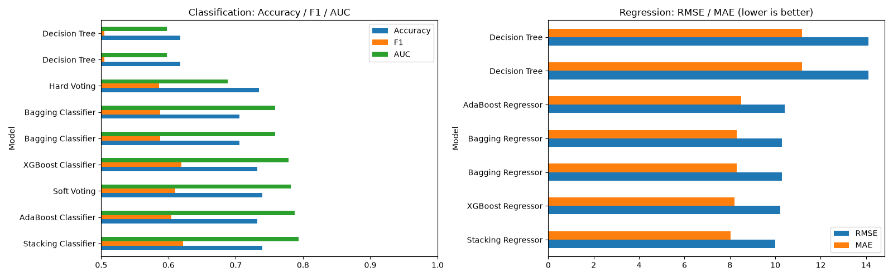
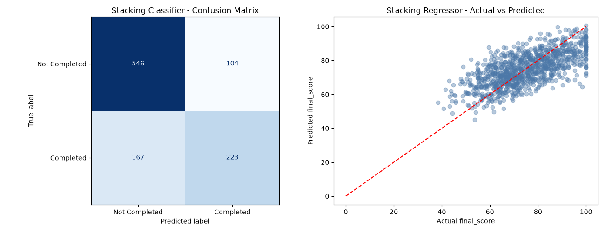

<p align="center">
  
</p>

<p align="center">
<a href="https://git.io/typing-svg"></a>
</p>
<br/>


**[Overview](#-overview) · [Demo](#-streamlit-app) · [Dataset](#-dataset) · [Pipeline](#-methodology) · [Results](#-results) · [Quick Start](#-quick-start) · [Author](#-author)**

</div>

---

## 📌 Overview

An EdTech platform wants to know **which students are likely to drop out** and **how well they will score**, early enough to help. **Smart Outcome Predictor** answers both questions with a family of ensemble models built on the same data and preprocessing:

| Task | Type | Target | Question |
|------|------|--------|----------|
| 🎯 Task 1 | Classification | `completion_status` | Will the student complete the course? |
| 📈 Task 2 | Regression | `final_score` | What final score (0–100) will the student achieve? |

Seven model families are compared (Decision Tree baseline, Bagging, AdaBoost, XGBoost, Hard/Soft Voting, Stacking). The best models are saved as full scikit-learn pipelines and served through an interactive **Streamlit** app.

### ✨ Highlights

- 🧪 End-to-end workflow: EDA → preprocessing → 7 ensemble methods → evaluation → deployment
- 🔒 Leakage-safe: preprocessing is fitted on training data only, and each target is excluded from the other task's features
- 🧱 Single `Pipeline` per task (scaling + KNN imputation + one-hot encoding + model), so raw inputs go straight to predictions
- 🏆 **Stacking** wins both tasks (AUC 0.793, RMSE 9.99)
- 🖥️ Streamlit app with live predictions, probability gauge and model comparison tables

---

## 🎬 Streamlit App

### Demo Video

<div align="center">

<a href="https://drive.google.com/file/d/YOUR_FILE_ID/view?usp=sharing">
  
</a>

<br/><br/>

<!-- Optional: click-to-play preview image. Save a screenshot of the app as Images/demo_thumbnail.png, then uncomment: -->
<!--
<a href="https://drive.google.com/file/d/YOUR_FILE_ID/view?usp=sharing">
  
</a>
-->

<sub>Opens in Google Drive. Make sure sharing is set to <b>"Anyone with the link → Viewer"</b>.</sub>

</div>

### App Features

| Tab | What it does |
|-----|--------------|
| 🔮 **Predict** | Enter a student profile (5 categorical + 10 numeric inputs) and get a completion verdict, completion probability and predicted final score |
| 📊 **Model Performance** | Metrics for the deployed Stacking models and the full comparison tables for every model |
| ℹ️ **About** | Pipeline summary, models compared and a usage disclaimer |

**Sample output:** a student is flagged *"Likely to complete"* when the predicted probability is ≥ 50%; otherwise *"At risk"*, with suggestions for reminders, mentoring or extra quiz practice. Scores are clipped to the 0–100 range.

### Run it locally

```bash
streamlit run app.py
```

### 🌐 Live App

<div align="center">

[](https://smartoutcomepredictor.streamlit.app/)

</div>

Locally, the app opens at `http://localhost:8501`. Model files must exist in `Models/` (generated by running the notebook).

---

## 📂 Dataset

**File:** `Dataset/Smart_Outcome_Predictor_Dataset.csv` · **5,200 students** · 19 columns

| Group | Columns |
|-------|---------|
| 🪪 Dropped (identifiers) | `student_id`, `course_start_date` |
| 🏷️ Categorical (5) | `country_region`, `device_type`, `education_background`, `course_level`, `course_category` |
| 🔢 Numeric (10) | `age`, `week_of_year`, `sessions`, `time_spent_hours`, `videos_watched`, `quiz_attempts`, `assignments_submitted`, `forum_posts`, `avg_quiz_score`, `attendance_rate` |
| 🎯 Targets (2) | `completion_status` (0/1), `final_score` (0–100) |

**Data quality notes**

- Missing values: `time_spent_hours` (112), `avg_quiz_score` (81), `attendance_rate` (80), handled with KNN imputation.
- Class imbalance: only **37.5%** of students completed the course, so an **80/20 stratified split** (`random_state=42`) is used.

<div align="center">

</div>

### 🔗 Correlation Insights

<div align="center">

</div>

- `avg_quiz_score` is the strongest predictor (**+0.34** with completion, **+0.52** with final score).
- `attendance_rate`, `sessions`, `videos_watched` and `time_spent_hours` follow.
- `age`, `week_of_year` and `forum_posts` show almost no linear relationship.
- `sessions` and `videos_watched` are highly correlated (0.81), which is fine for tree-based models.

---

## 🧠 Methodology



### Ensemble techniques

| Family | Models | Idea |
|--------|--------|------|
| 🌳 Baseline | Decision Tree | Single unpruned tree; memorises training data (train acc 1.00) |
| 🎒 Bagging | `BaggingClassifier` / `BaggingRegressor` (100 trees, OOB score) | Reduces **variance** by averaging bootstrapped trees |
| 🚀 Boosting | AdaBoost (200 stumps clf / 100 depth-4 trees reg, `lr=0.5`) · XGBoost (300 trees, `lr=0.05`, `max_depth=4`) | Reduces **bias** by sequentially correcting errors |
| 🗳️ Voting | Hard & Soft voting over LR, KNN, DT, SVM (Ridge, KNN, DT, SVR for regression) | Combines diverse models by label or averaged probability |
| 🧩 Stacking | Same four base models + Logistic Regression / Ridge meta-learner, 5-fold CV | Meta-learner learns how much to trust each base model |

### AdaBoost: sequential learning

<div align="center">

</div>

Performance rises quickly over the first tens of weak learners, then plateaus, a clear case of diminishing returns.

---

## 📊 Results

### Classification (test set, 1,040 students)

| Rank | Model | Accuracy | Precision | Recall | F1 | AUC |
|:----:|-------|:--------:|:---------:|:------:|:--:|:---:|
| 🥇 | **Stacking Classifier** | **0.739** | 0.682 | 0.572 | **0.622** | **0.793** |
| 🥈 | AdaBoost Classifier | 0.732 | 0.676 | 0.546 | 0.604 | 0.788 |
| 🥉 | Soft Voting | 0.739 | 0.695 | 0.544 | 0.610 | 0.782 |
| 4 | XGBoost Classifier | 0.732 | 0.662 | 0.582 | 0.619 | 0.779 |
| 5 | Bagging Classifier | 0.706 | 0.619 | 0.559 | 0.588 | 0.758 |
| 6 | Hard Voting | 0.735 | 0.707 | 0.500 | 0.586 | 0.688 |
| 7 | Decision Tree | 0.617 | 0.490 | 0.521 | 0.505 | 0.598 |

### Regression (test set)

| Rank | Model | MAE ↓ | RMSE ↓ | R² ↑ |
|:----:|-------|:-----:|:------:|:----:|
| 🥇 | **Stacking Regressor** | **8.03** | **9.99** | **0.451** |
| 🥈 | XGBoost Regressor | 8.20 | 10.21 | 0.428 |
| 🥉 | Bagging Regressor | 8.31 | 10.30 | 0.418 |
| 4 | AdaBoost Regressor | 8.49 | 10.41 | 0.405 |
| 5 | Decision Tree | 11.18 | 14.11 | -0.094 |

### 📈 Visual comparison

<div align="center">







</div>

### 🔍 Key findings

- **Ensembles beat a single tree on every metric.** AUC rises from 0.598 to 0.793 and regression R² from -0.09 to 0.45.
- **Bagging vs boosting.** Bagging cuts variance but its trees still fit the training set perfectly; boosting generalises slightly better by correcting errors sequentially.
- **Soft vs hard voting.** Soft voting (AUC 0.782) beats hard voting (0.688) because it keeps each model's confidence.
- **Stacking wins both tasks**, at the cost of longer training and a heavier deployment.
- **XGBoost is a strong, cheaper alternative** (AUC 0.779, RMSE 10.21), but it overfits more when unconstrained (train acc 0.836 vs test 0.732).
- **Recall is 0.57.** The model misses some completers, so it should support human review rather than replace it.

### 💼 Business interpretation

- Flag students with low completion probability for reminders, mentoring or quiz support (accuracy ≈ 74%, precision 0.68).
- Forecast final scores within about **±8 points** on average.
- Quiz performance, attendance, sessions and video engagement are the strongest levers for intervention.
- Richer data, such as weekly progress trends, is the best route to further improvement.

---

## 🚀 Quick Start

```bash
# 1. Clone the repository
git clone https://github.com/RENSEE-GAJIPARA/Smart-Outcome-Predictor.git
cd Smart-Outcome-Predictor

# 2. Create and activate a virtual environment
python -m venv venv
source venv/bin/activate        # Windows: venv\Scripts\activate

# 3. Install dependencies
pip install -r requirements.txt
pip install streamlit           # needed for the web app

# 4. (Optional) Re-train the models and regenerate Models/, Images/, Outputs/
jupyter notebook Notebook/smart_outcome_predictor.ipynb

# 5. Launch the Streamlit app
streamlit run app.py
```

### Predict from Python

```python
import pickle
import pandas as pd

cls_pipe = pickle.load(open("Models/completion_pipeline.pkl", "rb"))
reg_pipe = pickle.load(open("Models/score_pipeline.pkl", "rb"))

student = pd.DataFrame([{
    "age": 24, "country_region": "Asia", "device_type": "Laptop",
    "education_background": "Undergrad", "course_level": "Intermediate",
    "course_category": "Data", "week_of_year": 27, "sessions": 17,
    "time_spent_hours": 16.1, "videos_watched": 23, "quiz_attempts": 7,
    "assignments_submitted": 4, "forum_posts": 1,
    "avg_quiz_score": 66.9, "attendance_rate": 0.855,
}])

prob  = cls_pipe.predict_proba(student)[0, 1]
score = min(100, max(0, reg_pipe.predict(student)[0]))
print(f"Completion probability: {prob:.1%} | Predicted score: {score:.1f}")
```

> ⚠️ Pickle files are tied to the library versions in `requirements.txt`. Use the same versions (or re-run the notebook) to avoid compatibility errors.

---

## 🗂️ Project Structure

```text
Smart-Outcome-Predictor/
│
├── 📁 Dataset/
│   └── Smart_Outcome_Predictor_Dataset.csv
│
├── 📁 Notebook/
│   └── smart_outcome_predictor.ipynb      # EDA, modelling, evaluation, export
│
├── 📁 Models/
│   ├── completion_pipeline.pkl            # Stacking Classifier pipeline
│   ├── score_pipeline.pkl                 # Stacking Regressor pipeline
│   └── final_metrics.json                 # Metrics + UI metadata for the app
│
├── 📁 Outputs/
│   ├── classification_results.csv
│   └── regression_results.csv
│
├── 📁 Images/                             # Charts used in this README
│   ├── 01.class_disribution.png
│   ├── 02_correlation_heatmap.png
│   ├── 03_adaboost_sequential.png
│   ├── 04_roc_curves.png
│   ├── 05_model_comparison.png
│   └── 06_best_models.png
│
├── 📁 Docs/
│   ├── Ensemble_Learning_Theory.pdf
│   └── Final_Report_Smart_Outcome_Predictor.pdf
│
├── 📄 app.py                              # Streamlit application
├── 📄 requirements.txt
└── 📄 README.md
```

---

## 🛠️ Tech Stack

| Category | Tools |
|----------|-------|
| Language | Python |
| Data | NumPy 2.5.2 · Pandas 3.0.6 |
| Visualisation | Matplotlib 3.11.0 · Seaborn 0.13.2 |
| Modelling | scikit-learn 1.9.1 · XGBoost 3.2.0 |
| Deployment | Streamlit |
| Environment | Jupyter 1.1.1 |

---

## 📚 Documentation

- 📘 [Ensemble Learning Theory](Docs/Ensemble_Learning_Theory.pdf): bagging, boosting, voting and stacking concepts
- 📕 [Final Report](Docs/Final_Report_Smart_Outcome_Predictor.pdf): methodology, results, comparison and recommendations

---

## ⚠️ Limitations & Future Work

- Predictions are **estimates to support early intervention**, not final decisions about students.
- Recall for completers is moderate (0.57); the available features are mostly cumulative engagement totals.
- Planned improvements: weekly progress time-series features, probability calibration and threshold tuning, SHAP-based explanations, and hyperparameter search for the stacking meta-learner.

---

## 👤 Author

<div align="center">


**B.Tech in Artificial Intelligence & Data Science** · SCET, Surat, Gujarat

<a href="https://www.linkedin.com/in/rensee-gajipara"></a>
<a href="mailto:renseegajipara@gmail.com"></a>
<a href="https://github.com/RENSEE-GAJIPARA"></a>

<br/><br/>

⭐ **If you found this project useful, please consider giving it a star!** ⭐


</div>
